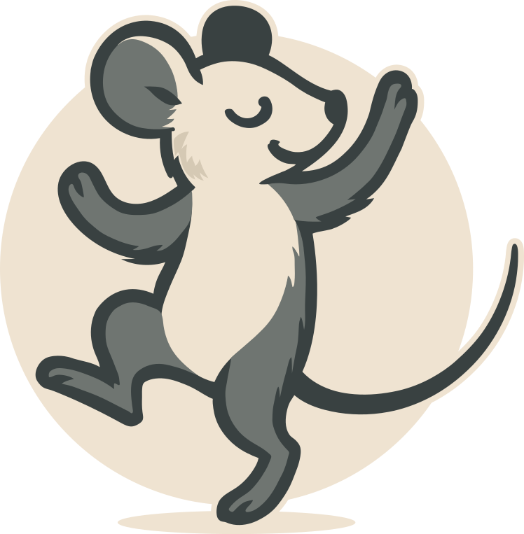

<p align="center">
  <br/>
  <h1 align="center">Animouse</h1>
  <p align="center">
      An animation state machine and blending system for Three.js that I use in my daily work with 3D development.
  </p>
</p>

<p align="center">
<a href="https://www.npmjs.com/package/animouse"></a>
<a href="https://bundlephobia.com/package/animouse"></a>
<a href="https://opensource.org/licenses/MIT"></a>
<a href="https://www.typescriptlang.org/"></a>
<a href="https://threejs.org/"></a>
</p>

## What's included

- 🎬 **Animation State Machine** - Event-driven and data-driven transitions
- 🎯 **Single Clip States** - Animation control with lifecycle events
- 📊 **Linear Blend Trees** - 1D blending for speed variations
- 🧭 **Polar Blend Trees** - 2D blending in polar coordinates
- 🎨 **Freeform Blend Trees** - 2D blending using Delaunay triangulation
- 🦶 **Phase Synchronization** - Clips of different length keep one cycle, also across transitions
- 🔄 **Transitions** - Configurable blend durations between states
- 📦 **TypeScript Support** - Type safety and IntelliSense

## Installation

```bash
npm install animouse
```

## Requirements

- Three.js >=0.157.0 <0.188.0 (peer dependency)
- Modern JavaScript environment with ES2020+ support

## Examples

🎮 **[Live Examples](https://jango-git.github.io/animouse/)** - Interactive demos showing Animouse in action

Browse working examples that demonstrate:

- Basic GLB character animation loading and playback
- Integration with Three.js scene setup
- Real-time animation control

Visit the examples page to see the library in action!

## Quick Start

```typescript
import { LinearBlendTree, AnimationMachine } from "animouse";
import { AnimationMixer, Vector2 } from "three";

// Setup Three.js animation mixer with your loaded character
const mixer = new AnimationMixer(character);

// Create linear blend tree for movement speed
const movementTree = new LinearBlendTree([
  { action: mixer.clipAction(idleClip), value: 0 }, // Idle
  { action: mixer.clipAction(walkClip), value: 0.5 }, // Walk
  { action: mixer.clipAction(runClip), value: 1 }, // Run
]);

// Create state machine
const machine = new AnimationMachine(movementTree, mixer);

// Input handling
const movementInput = new Vector2(0, 0);

function handleInput() {
  // Get movement input (WASD, gamepad, etc.)
  const inputMagnitude = movementInput.length();

  // Blend animations based on movement speed
  // 0 = idle, 0.5 = walk, 1 = run
  movementTree.setBlend(inputMagnitude);
}

// Main update loop
function animate() {
  const deltaTime = clock.getDelta();

  handleInput(); // Update input and blend values
  machine.update(deltaTime); // Update state machine and animations

  renderer.render(scene, camera);
  requestAnimationFrame(animate);
}
```

## How it works

### Animation States

Animation states manage one or more Three.js AnimationActions:

- **ClipState** - Wraps a single AnimationAction
- **LinearBlendTree** - Blends multiple actions along a 1D axis
- **PolarBlendTree** - Blends actions in 2D polar coordinates
- **FreeformBlendTree** - Blends actions in 2D space

### Animation Machine

The AnimationMachine handles state transitions. It supports three types:

1. **Event Transitions** - Triggered by specific events
2. **Automatic Transitions** - Triggered when animations complete
3. **Data Transitions** - Triggered by condition evaluation

## Animation States

### ClipState - Single Animation Control

Control individual animation clips with event handling:

```typescript
import { ClipState } from "animouse";

const jumpState = new ClipState(jumpAction);
jumpState.name = "jump"; // Optional: name states for debugging

// Listen for animation events
jumpState.signalPlay.on((action, state) => {
  console.log("Jump animation started");
});

jumpState.signalFinish.on((action, state) => {
  console.log("Jump animation completed");
});
```

### LinearBlendTree - 1D Animation Blending

For speed variations or linear progressions:

```typescript
import { LinearBlendTree } from "animouse";

// Create speed-based movement blend tree
const movementTree = new LinearBlendTree([
  { action: idleAction, value: 0, isSynchronized: false }, // Stationary
  { action: walkAction, value: 1 }, // Slow movement
  { action: jogAction, value: 2 }, // Medium movement
  { action: runAction, value: 3 }, // Fast movement
  { action: sprintAction, value: 4 }, // Maximum speed
]);

// Blend based on movement speed
movementTree.setBlend(2.5); // Blend between jog and run

// Get current blend value
console.log("Current speed:", movementTree.blendValue); // 2.5
```

### PolarBlendTree - 2D Polar Blending

For directional movement with varying intensities:

```typescript
import { PolarBlendTree } from "animouse";
import { MathUtils } from "three";

// Create directional movement system
const directionTree = new PolarBlendTree(
  [
    // Walk speed (radius = 1)
    { action: walkForwardAction, radius: 1, azimuth: MathUtils.degToRad(0) },
    { action: walkLeftAction, radius: 1, azimuth: MathUtils.degToRad(-90) },
    { action: walkRightAction, radius: 1, azimuth: MathUtils.degToRad(90) },
    { action: walkBackAction, radius: 1, azimuth: MathUtils.degToRad(180) },

    // Run speed (radius = 2)
    { action: runForwardAction, radius: 2, azimuth: MathUtils.degToRad(0) },
    { action: runLeftAction, radius: 2, azimuth: MathUtils.degToRad(-90) },
    { action: runRightAction, radius: 2, azimuth: MathUtils.degToRad(90) },
    { action: runBackAction, radius: 2, azimuth: MathUtils.degToRad(180) },
  ],
  { action: idleAction, isSynchronized: false }, // Optional center action
);

// Blend to northeast at medium speed
directionTree.setBlend(MathUtils.degToRad(45), 1.5);

// Get current blend values
console.log("Current direction:", directionTree.blendValue);
// { azimuth: 0.785, radius: 1.5 }
```

### FreeformBlendTree - 2D Blending

For irregular animation spaces:

```typescript
import { FreeformBlendTree } from "animouse";

// Create emotion-based facial animation system
const emotionTree = new FreeformBlendTree([
  { action: neutralAction, x: 0, y: 0 }, // Center: neutral
  { action: happyAction, x: 1, y: 1 }, // Happy
  { action: sadAction, x: -1, y: -0.5 }, // Sad
  { action: angryAction, x: -0.8, y: 0.9 }, // Angry
  { action: surprisedAction, x: 0.2, y: 1.2 }, // Surprised
  { action: disgustAction, x: -1.2, y: 0.1 }, // Disgust
]);

// Blend to slightly happy and excited
emotionTree.setBlend(0.6, 0.8);

// Get current blend position
console.log("Current emotion:", emotionTree.blendValue); // { x: 0.6, y: 0.8 }
```

### Synchronization

The synchronized actions of a state share one phase, the position in the cycle from 0 to 1. Each
frame the phase advances by the frame time divided by the weighted mean duration of the blended
clips, and every clip plays at `phase * duration`. A 1 s walk forward and a 0.96 s walk right
stay in step this way, and a clip that starts blending in joins at the current phase instead of
its first frame.

```typescript
const strafeTree = new PolarBlendTree(
  [
    { action: walkForwardAction, radius: 1, azimuth: 0 },
    { action: walkRightAction, radius: 1, azimuth: Math.PI / 2, phaseOffset: 0.1 },
    { action: walkBackAction, radius: 1, azimuth: Math.PI },
    { action: walkLeftAction, radius: 1, azimuth: -Math.PI / 2 },
  ],
  { action: idleAction, isSynchronized: false },
);
```

- The clips need the same cycle layout. A walk cycle has the same number of steps in every clip,
  and the same foot touches the ground at the same phase. `phaseOffset` shifts a clip whose cycle
  starts at another point, in cycles of that clip.
- Blend trees synchronize `LoopRepeat` actions by default, a `ClipState` does not. With
  `isSynchronized: false` an action plays at its own time, which suits idle and clips without a
  cycle. `isSynchronized: true` on an action that does not use `LoopRepeat` throws.
- A state sets `time` and `timeScale` of its actions every frame, so values set by hand are
  overwritten. The playback speed is set on the state, see [Playback Speed](#playback-speed).

#### Sync Groups

The phase belongs to a `SyncGroup`. Every state has its own group, and states that share one keep
their steps in step through a transition between them.

```typescript
import { ClipState, SyncGroup } from "animouse";

const locomotion = new SyncGroup();
strafeTree.syncGroup = locomotion;

const sprintState = new ClipState(sprintAction, { isSynchronized: true });
sprintState.syncGroup = locomotion;
```

- While both states play, the phase advances once per frame from the actions of both, weighted
  by the influence of their state. A state that enters the group joins at the current phase.
- The phase restarts from 0 when a state of the group starts playing while no other state of it
  plays.
- The group of a state can be changed only while the state does not play, otherwise the setter
  throws.

### Playback Speed

`timeScale` of a state, 1 by default, scales the playback of all its actions. It can follow the
speed of the character, so the feet do not slide when the character moves faster or slower than
the clips were authored for.

```typescript
strafeTree.timeScale = characterSpeed / authoredSpeed;
```

- For synchronized actions it scales the phase rate. In a shared group each action counts with
  the time scale of its own state, weighted like its duration.
- `mixer.timeScale` scales every state of the mixer on top of that.

## State Machine Transitions

### Event-Driven Transitions

Respond to game events or user input:

```typescript
// Basic transition
machine.addEventTransition("jump", {
  from: idleState,
  to: jumpState,
  duration: 0.2,
});

// Conditional transition
machine.addEventTransition("attack", {
  to: attackState,
  duration: 0.1,
  condition: (from, to, event, weaponType) => weaponType === "sword",
});

// Trigger transitions
machine.handleEvent("jump");
machine.handleEvent("attack", "sword");
```

### Automatic Transitions

Transition when animations complete:

```typescript
// Transition to falling after jump completes
machine.addAutomaticTransition(jumpState, {
  to: fallState,
  duration: 0.1,
});

// Chain multiple animations
machine.addAutomaticTransition(landState, {
  to: idleState,
  duration: 0.3,
});
```

### Data-Driven Transitions

Evaluate conditions for state changes:

```typescript
// Transition based on health
machine.addDataTransition(combatState, {
  to: deathState,
  duration: 0.5,
  condition: (from, to, health) => health <= 0,
  data: [character.health],
});
```

## Animation Events

Each animation state exposes its lifecycle events as typed
[ferrsign](https://www.npmjs.com/package/ferrsign) signals. `on` and `once` return a function that
removes the callback.

```typescript
// State lifecycle events, called with the state
state.signalEnter.on((state) => {
  console.log("State activated");
});

state.signalExit.on((state) => {
  console.log("State deactivated");
});

// Animation playback events, called with the action and the state
const unsubscribe = state.signalPlay.on((action, state) => {
  console.log("Animation started playing");
});

state.signalStop.on((action, state) => {
  console.log("Animation stopped");
});

// Animation completion events
state.signalIterate.on((action, state) => {
  console.log("Looped animation completed a cycle");
});

state.signalFinish.on((action, state) => {
  console.log("Non-looped animation finished");
});

unsubscribe();
```

## Time Events

Time-based events that trigger callbacks at specific points during animation playback. Useful for synchronizing sound effects or other events with animation frames.

### ClipState Time Events

For single animation clips, register time events directly on the state:

```typescript
import { ClipState } from "animouse";

const walkState = new ClipState(walkAction);

// Trigger footstep sound at 25% and 75% of the walk cycle
walkState.onTimeEvent(0.25, (action, state) => {
  playSound("footstep-left");
});

walkState.onTimeEvent(0.75, (action, state) => {
  playSound("footstep-right");
});

// One-time event for attack impact
const attackState = new ClipState(attackAction);
attackState.onceTimeEvent(0.6, (action, state) => {
  dealDamage();
  showImpactEffect();
});
```

### Blend Tree Time Events

For blend trees, specify which action to monitor:

```typescript
import { type AnimationState, LinearBlendTree } from "animouse";
import type { AnimationAction } from "three";

const movementTree = new LinearBlendTree([
  { action: walkAction, value: 1 },
  { action: runAction, value: 2 },
]);

// Add footstep events to specific actions
const footstepCallback = (action: AnimationAction, state: AnimationState): void => {
  playSound("walk-footstep");
};
movementTree.onTimeEvent(walkAction, 0.5, footstepCallback);

movementTree.onTimeEvent(runAction, 0.3, (action, state) => {
  playSound("run-footstep");
});

// Remove events when no longer needed
movementTree.offTimeEvent(walkAction, 0.5, footstepCallback);
```

Time events fire when the animation crosses the specified time threshold (0.0 to 1.0). Times are
rounded to hundredths. A looping action that passes the end of its cycle in one frame also fires
the events at the start of the next cycle. The crossing follows the state `timeScale` and
`mixer.timeScale`, and for a synchronized action it follows the phase. `offTimeEvent` removes only the given callback, and does nothing if it is
not registered at that time.

## Performance Notes

- Blend trees update only active animations (weight > 0)
- Animation actions are automatically started/stopped based on weights
- Use data transitions carefully for frequently evaluated conditions
- Event transitions work well for user input and game events
- States can be named for easier debugging and identification

## Contributing

Feel free to submit issues and pull requests if you find this library helpful.

1. Fork the repository
2. Create a feature branch
3. Make your changes with tests
4. Submit a pull request

## License

MIT © [jango](https://github.com/jango-git)

## Credits

- Built with [Three.js](https://threejs.org/) for 3D animation support
- Events use [ferrsign](https://www.npmjs.com/package/ferrsign) signals
- Freeform blend spaces are triangulated with [delaunator](https://www.npmjs.com/package/delaunator)
